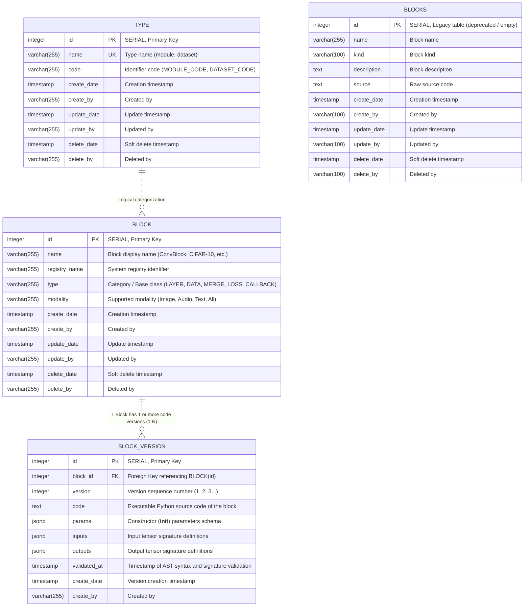

# Entity Relationship Diagram (ERD) - Webapp Database

Design documentation for the Entity Relationship Diagram (ERD) and Data Dictionary for the PostgreSQL database of the **Pipeline Builder & Deep Learning Framework Generator** project.

---

## 1. Entity Relationship Diagram (ERD)

---

## 2. Why are there two tables: `block` and `blocks`?

| Table | Status | Records | Purpose |
| :--- | :--- | :--- | :--- |
| **`block`** | **Active (In Use)** | 21 rows | Stores core block metadata. Part of the normalized 1-to-many relationship with `block_version`. Connected to the SQLAlchemy model in `app/models/block.py`. |
| **`block_version`** | **Active (In Use)** | 21 rows | Stores the executable Python code, JSONB parameters, tensor inputs, and outputs per version. |
| **`blocks`** | **Deprecated (Legacy)** | 0 rows | An early prototype table created before schema normalization. It stored flat data (`source`, `description`, `kind`) with no multi-version support and is **not referenced anywhere in the current application code**. |

> **Key takeaway:** The application active schema uses **`block`** + **`block_version`**. The table **`blocks`** is an obsolete remnant left over from initial database prototyping and can be safely ignored or dropped.

---

## 3. Data Dictionary

### A. Table `block` (Active - Primary DL Component Catalog)
Manages high-level metadata and registry information for each deep learning block:

| Column Name | Data Type | Constraints | Description |
| :--- | :--- | :--- | :--- |
| `id` | `INTEGER` | `PRIMARY KEY, AUTOINCREMENT` | Auto-incrementing primary key (`nextval('block_id_seq')`) |
| `name` | `VARCHAR(255)` | `NOT NULL` | Display name of the block (e.g. `ConvNextBlock`, `CIFAR-10`) |
| `registry_name` | `VARCHAR(255)` | `NOT NULL` | Unique registry key in `DeepLearning_Framework` |
| `type` | `VARCHAR(255)` | `NOT NULL` | Functional category (`LAYER`, `DATA`, `MERGE`, `LOSS`, `CALLBACK`) |
| `modality` | `VARCHAR(255)` | `NULLABLE` | Modality compatibility (`Image`, `Audio`, `Text`, `Classification`, `All`) |
| `create_date` | `TIMESTAMP` | `NULLABLE` | Creation timestamp |
| `create_by` | `VARCHAR(255)` | `NULLABLE` | Author / Creator username |
| `update_date` | `TIMESTAMP` | `NULLABLE` | Last modification timestamp |
| `update_by` | `VARCHAR(255)` | `NULLABLE` | Last updated by |
| `delete_date` | `TIMESTAMP` | `NULLABLE` | Soft deletion timestamp (`NULL` if active) |
| `delete_by` | `VARCHAR(255)` | `NULLABLE` | User who performed soft deletion |

---

### B. Table `block_version` (Active - Code & Signature Versions)
Stores Python source code revisions, AST-validated parameters, inputs, and outputs for each block:

| Column Name | Data Type | Constraints | Description |
| :--- | :--- | :--- | :--- |
| `id` | `INTEGER` | `PRIMARY KEY, AUTOINCREMENT` | Auto-incrementing primary key (`nextval('block_version_id_seq')`) |
| `block_id` | `INTEGER` | `FOREIGN KEY (block.id) NOT NULL` | Reference to parent `block.id` (`ON DELETE CASCADE`) |
| `version` | `INTEGER` | `NOT NULL` | Incremental version number (v1 = 1, v2 = 2, ...) |
| `code` | `TEXT` | `NOT NULL` | Full Python source code implementing the class |
| `params` | `JSONB` | `NULLABLE` | List of `__init__` constructor parameter definitions |
| `inputs` | `JSONB` | `NULLABLE` | Input tensor signature definitions (e.g. `["in [B,C,H,W]"]`) |
| `outputs` | `JSONB` | `NULLABLE` | Output tensor signature definitions (e.g. `["out [B,C,H,W]"]`) |
| `validated_at` | `TIMESTAMP` | `NULLABLE` | AST validation timestamp |
| `create_date` | `TIMESTAMP` | `NULLABLE` | Version creation timestamp |
| `create_by` | `VARCHAR(255)` | `NULLABLE` | Author of this version |

**Unique Constraint:**
- `UNIQUE (block_id, version)`: Ensures no duplicate version numbers exist for the same block.

---

### C. Table `type` (Active - System Category Catalog)
Lookup table for system-level component classifications:

| Column Name | Data Type | Constraints | Description |
| :--- | :--- | :--- | :--- |
| `id` | `INTEGER` | `PRIMARY KEY, AUTOINCREMENT` | Primary key |
| `name` | `VARCHAR(255)` | `UNIQUE, NOT NULL` | Type name (`module`, `dataset`) |
| `code` | `VARCHAR(255)` | `NOT NULL` | Code constant (`MODULE_CODE`, `DATASET_CODE`) |
| `create_date` - `delete_by` | `TIMESTAMP / VARCHAR` | `NULLABLE` | Standard audit fields |

---

### D. Table `blocks` (Deprecated - Legacy Prototype)
The unnormalized initial schema table (currently empty, 0 records):

| Column Name | Data Type | Constraints | Description |
| :--- | :--- | :--- | :--- |
| `id` | `INTEGER` | `PRIMARY KEY` | Primary key |
| `name` | `VARCHAR(255)` | `NOT NULL` | Block name |
| `kind` | `VARCHAR(100)` | `NOT NULL` | Block category |
| `description` | `TEXT` | `NOT NULL` | Block description text |
| `source` | `TEXT` | `NULLABLE` | Single-version source code column |
| `create_date` - `delete_by` | `TIMESTAMP / VARCHAR` | `NOT NULL / NULLABLE` | Audit fields |
