# Entity Relationship Diagram (ERD) - Webapp Database

Tài liệu thiết kế sơ đồ quan hệ thực thể (ERD) và từ điển dữ liệu (Data Dictionary) cho cơ sở dữ liệu PostgreSQL của dự án **Pipeline Builder & Deep Learning Framework Generator**.

---

## 1. Sơ Đồ Quan Hệ Thực Thể (ERD Diagram)

```mermaid
erDiagram
    TYPE {
        integer id PK "SERIAL, Khóa chính"
        varchar(255) name UK "Tên loại (module, dataset)"
        varchar(255) code "Mã code định danh (MODULE_CODE, DATASET_CODE)"
        timestamp create_date "Thời điểm tạo"
        varchar(255) create_by "Người tạo"
        timestamp update_date "Thời điểm cập nhật"
        varchar(255) update_by "Người cập nhật"
        timestamp delete_date "Thời điểm xóa mềm"
        varchar(255) delete_by "Người xóa"
    }

    BLOCK {
        integer id PK "SERIAL, Khóa chính"
        varchar(255) name "Tên hiển thị của Block (ConvBlock, CIFAR-10...)"
        varchar(255) registry_name "Tên định danh trong Registry hệ thống"
        varchar(255) type "Phân loại / Base class (LAYER, DATA, MERGE, LOSS, CALLBACK, nn.Module)"
        varchar(255) modality "Kiểu dữ liệu modality (Image, Audio, Text, Classification, All)"
        timestamp create_date "Thời điểm tạo"
        varchar(255) create_by "Người tạo"
        timestamp update_date "Thời điểm cập nhật"
        varchar(255) update_by "Người cập nhật"
        timestamp delete_date "Thời điểm xóa mềm (soft delete)"
        varchar(255) delete_by "Người thực hiện xóa"
    }

    BLOCK_VERSION {
        integer id PK "SERIAL, Khóa chính"
        integer block_id FK "Khóa ngoại tham chiếu BLOCK(id)"
        integer version "Số thứ tự phiên bản (1, 2, 3...)"
        text code "Mã nguồn Python thực thi của block"
        jsonb params "Danh sách tham số khởi tạo __init__ (JSON/JSONB)"
        jsonb inputs "Định nghĩa input tensors/signatures (JSON/JSONB)"
        jsonb outputs "Định nghĩa output tensors/signatures (JSON/JSONB)"
        timestamp validated_at "Thời điểm được kiểm tra/validate AST thành công"
        timestamp create_date "Thời điểm tạo phiên bản"
        varchar(255) create_by "Người tạo phiên bản"
    }

    BLOCKS {
        integer id PK "SERIAL, Khóa chính"
        varchar(255) name "Tên block"
        varchar(100) kind "Loại block"
        text description "Mô tả block"
        text source "Mã nguồn tham chiếu"
        timestamp create_date "Thời điểm tạo"
        varchar(100) create_by "Người tạo"
        timestamp update_date "Thời điểm cập nhật"
        varchar(100) update_by "Người cập nhật"
        timestamp delete_date "Thời điểm xóa"
        varchar(100) delete_by "Người xóa"
    }

    BLOCK ||--o{ BLOCK_VERSION : "có 1 hoặc nhiều phiên bản (1:N)"
    TYPE ||..o{ BLOCK : "định nghĩa phân loại thực thi (logical)"
```

---

## 2. Chi Tiết Các Bảng & Ràng Buộc (Data Dictionary)

### A. Bảng `block` (Catalog khối Deep Learning chính)
Quản lý thông tin định danh và siêu dữ liệu cấp cao của từng Block:

| Tên Cột | Kiểu Dữ Liệu | Ràng Buộc | Ý Nghĩa / Ghi Chú |
| :--- | :--- | :--- | :--- |
| `id` | `INTEGER` | `PRIMARY KEY, AUTOINCREMENT` | Khóa chính tự tăng (`nextval('block_id_seq')`) |
| `name` | `VARCHAR(255)` | `NOT NULL` | Tên của khối block (ví dụ: `ConvNextBlock`, `CIFAR-10`) |
| `registry_name` | `VARCHAR(255)` | `NOT NULL` | Khóa định danh file/registry trong `DeepLearning_Framework` |
| `type` | `VARCHAR(255)` | `NOT NULL` | Phân loại chức năng (`LAYER`, `DATA`, `MERGE`, `LOSS`, `CALLBACK` hoặc base class) |
| `modality` | `VARCHAR(255)` | `NULLABLE` | Kiểu dữ liệu tương thích (`Image`, `Audio`, `Text`, `Classification`, `All`) |
| `create_date` | `TIMESTAMP` | `NULLABLE` | Thời điểm tạo record |
| `create_by` | `VARCHAR(255)` | `NULLABLE` | Người tạo |
| `update_date` | `TIMESTAMP` | `NULLABLE` | Thời điểm chỉnh sửa gần nhất |
| `update_by` | `VARCHAR(255)` | `NULLABLE` | Người sửa |
| `delete_date` | `TIMESTAMP` | `NULLABLE` | Đánh dấu xóa mềm (Soft Delete) nếu khác `NULL` |
| `delete_by` | `VARCHAR(255)` | `NULLABLE` | Người thực hiện xóa |

---

### B. Bảng `block_version` (Các phiên bản mã nguồn của Block)
Lưu trữ lịch sử phiên bản code Python, tham số cấu hình, inputs và outputs:

| Tên Cột | Kiểu Dữ Liệu | Ràng Buộc | Ý Nghĩa / Ghi Chú |
| :--- | :--- | :--- | :--- |
| `id` | `INTEGER` | `PRIMARY KEY, AUTOINCREMENT` | Khóa chính tự tăng (`nextval('block_version_id_seq')`) |
| `block_id` | `INTEGER` | `FOREIGN KEY (block.id) NOT NULL` | Tham chiếu tới bảng `block(id)` |
| `version` | `INTEGER` | `NOT NULL` | Số thứ tự phiên bản (v1 = 1, v2 = 2...) |
| `code` | `TEXT` | `NOT NULL` | Toàn bộ mã nguồn Python của Class |
| `params` | `JSONB` | `NULLABLE` | Danh sách tham số `__init__` dạng JSON |
| `inputs` | `JSONB` | `NULLABLE` | Tín hiệu tensor đầu vào (ví dụ `["in [B,C,H,W]"]`) |
| `outputs` | `JSONB` | `NULLABLE` | Tín hiệu tensor đầu ra (ví dụ `["out [B,C,H,W]"]`) |
| `validated_at` | `TIMESTAMP` | `NULLABLE` | Thời điểm chạy qua AST parser xác nhận hợp lệ |
| `create_date` | `TIMESTAMP` | `NULLABLE` | Thời điểm phát hành version |
| `create_by` | `VARCHAR(255)` | `NULLABLE` | Người commit version |

**Ràng buộc đặc biệt:**
- `UNIQUE (block_id, version)`: Đảm bảo một Block không thể tồn tại 2 phiên bản trùng số hiệu.

---

### C. Bảng `type` (Danh mục kiểu dữ liệu khối)
Lưu danh sách phân loại hệ thống (ví dụ: `module`, `dataset`):

| Tên Cột | Kiểu Dữ Liệu | Ràng Buộc | Ý Nghĩa |
| :--- | :--- | :--- | :--- |
| `id` | `INTEGER` | `PRIMARY KEY, AUTOINCREMENT` | Khóa chính |
| `name` | `VARCHAR(255)` | `UNIQUE, NOT NULL` | Tên (`module`, `dataset`, ...) |
| `code` | `VARCHAR(255)` | `NOT NULL` | Mã code (`MODULE_CODE`, `DATASET_CODE`) |
| `create_date`, `update_date`, `delete_date` | `TIMESTAMP` | `NULLABLE` | Audit fields |

---

## 3. Quan Hệ (Relationships)

1. **`BLOCK` - `BLOCK_VERSION` (Quan hệ 1 : N)**:
   - Một `BLOCK` có thể có nhiều phiên bản mã nguồn (`BLOCK_VERSION`).
   - Khóa ngoại `block_version.block_id` tham chiếu đến `block.id`.
   - Khi truy vấn khối, hệ thống lấy `BlockVersion` có số phiên bản mới nhất (`version.desc()`).
2. **`TYPE` - `BLOCK`**:
   - `type.name` định nghĩa danh mục module/dataset được dùng để phân chia trong quy trình kiểm duyệt block.
